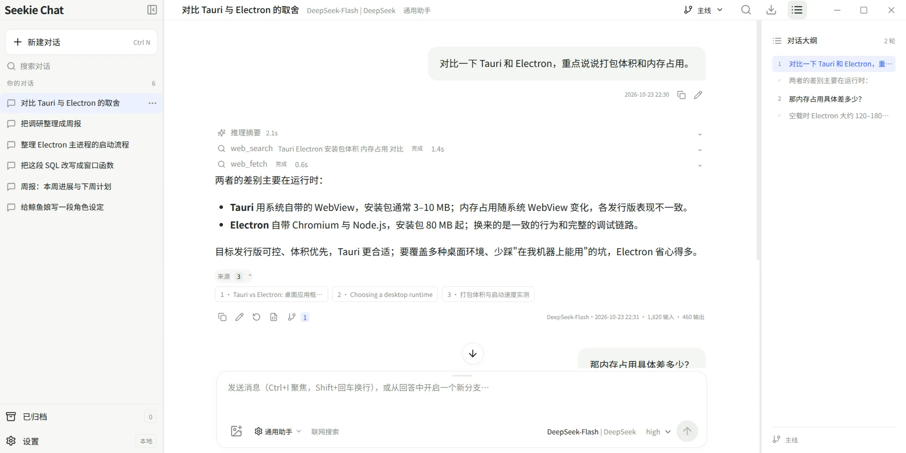
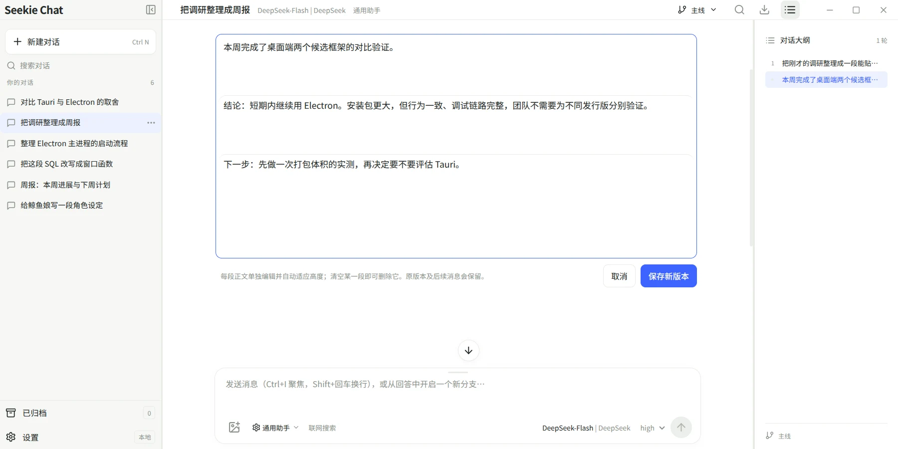

# Seekie Chat

Linux 桌面 LLM 聊天客户端。Electron + React + TypeScript，默认浅色主题，聊天数据保存在本机。

<sub>基于 MIT License 开源。Seekie Chat 是非官方的第三方客户端，与 DeepSeek 官方无隶属关系。</sub>

  





> **多段正文编辑**
>
> 当一条回答被推理和工具调用隔成好几段正文（推理 → 正文 → 工具 → 正文 → 推理 → 正文），编辑会为每一段各开一个输入框，保存时按原位置写回，中间的推理与工具调用保持不动；清空某一段就等于删掉它。
>
> 编辑框刻意画成"一整块文本框、块间一条细线"，而不是几个并排的输入框——它表达的仍然是一段完整的回答。

<sub>更多界面截图见 [docs/screenshots.md](docs/screenshots.md)。</sub>

[安装](#安装) · [本地运行](#本地运行) · [开始聊天](#开始聊天) · [Gemini 原生协议](#gemini-原生协议) · [系统提示词库与角色预设](#系统提示词库与角色预设) · [已实现](#已实现) · [搜索与思考](#搜索与思考) · [数据路径与安全](#数据路径与安全) · [安装与打包](#安装与打包) · [验证](#验证) · [出问题了先看这里](#出问题了先看这里) · [当前边界](#当前边界)

## 安装

不想自己编译的话，从 [Releases](https://github.com/shellexy/seekie-chat/releases) 下载对应平台的产物：

- **Linux deb**（`seekie-chat_<版本>_amd64.deb`）：`sudo dpkg -i` 安装。装完命令行敲 `seekie-chat`，或从应用菜单启动。
- **Linux AppImage**（`seekie-chat-<版本>-x86_64.AppImage`）：`chmod +x` 后直接运行，免安装。
- **Windows**（`seekie-chat-<版本>-setup.exe`）：一键安装到当前用户目录。安装包未签名，首次运行会提示“未知发布者”。

想从源码运行见下一节；自己打包见[安装与打包](#安装与打包)。

## 本地运行

要求 **Node.js 24 或更高版本**、npm，以及能运行 Electron 的 Linux 桌面环境。

```bash
npm install
npm run dev
```

`npm run dev` 启动 Vite 和 Electron。前端支持热更新，修改 `electron/` 中的主进程或 preload 后需要重启。关闭 Electron 窗口或在终端按 Ctrl+C，会关闭开发服务。当前无需打包。

Electron 44 首次使用时可能下载桌面运行时。如果网络需要代理，可使用：

```bash
ELECTRON_GET_USE_PROXY=1 npm run dev
```

Electron 的 Chromium 沙箱需要 Linux 正常配置用户命名空间。请以普通用户运行，不要使用 root 或关闭沙箱。极简系统可能还需要 GTK、NSS、GBM、音频等 Electron 系统库。

## 开始聊天

还没有 API Key 时，设置页“模型服务”的空状态和新建对话页都提供“还没有 API？点击一键添加免费体验模型”：一键添加一条 `OpenRouter·Kilo` 连接（OpenAI 兼容协议，地址 `https://api.kilo.ai/api/openrouter`，密钥固定为 `anonymous`）和模型 `Auto Free`（模型 ID `kilo-auto/free`，上下文 256,000 token、最大输出 65,536 token，启用图片输入与工具调用，思考参数为思考等级、默认 `low`），加好即可直接开始聊。

1. 打开左下角设置，添加 OpenAI Responses、OpenAI Chat Completions、Anthropic、DeepSeek（Anthropic Messages）、Gemini、Ollama、Ollama Cloud 或自定义兼容连接。
2. 填写 Base URL 和 API Key。地址可以包含 `/v1` 或 `/v1beta`，不要包含 `/responses`、`/messages` 等端点。
3. 测试连接获取模型列表，或手动添加供应商提供的准确模型 ID。“添加服务端模型”对话框的列表上方有搜索框，按展示名或模型 ID 过滤，右侧显示匹配数；“全选”只作用于当前筛选出的模型。
4. 根据模型文档填写上下文窗口、最大输出、图片、视频、音频、PDF、工具、原生搜索及思考能力。
5. 选择默认聊天模型。标题模型和压缩模型可以独立选择，也可以继承聊天模型。
6. 切换到别的设置项或返回聊天，改动会自动保存，新建对话即可。

DeepSeek 官方提供 Anthropic、OpenAI 兼容与 Responses 三种协议，但**只有 Anthropic 协议提供服务端内置搜索**，且该内置搜索按官方说明将于 2026 年 11 月 1 日起按次收费。因此提供两个预设：“+ DeepSeek”使用 OpenAI 兼容协议与 `https://api.deepseek.com/`（自动拼成 `/v1/chat/completions`），联网搜索改用显式的“DeepSeek 搜索”，调用次数、来源与费用都可见可控；“+ DeepSeek·Anthropic”使用 Anthropic Messages 与 `https://api.deepseek.com/anthropic`，保留服务端原生搜索。

两者都自动添加 `deepseek-flash`（展示名称写作“DeepSeek-Flash”，模型 ID 仍是服务端的 `deepseek-flash`），上下文窗口为 1,048,576 token、最大输出为 393,216 token（384K），启用图片输入与工具调用，思考参数默认选择“思考等级（effort）”；只有 Anthropic 预设勾选原生搜索。已存在的连接不受预设改动影响，仍按各自的协议继续使用。填写你自己的 API Key 后保存即可。

OpenAI 预设名为“+ OpenAI”，默认使用 Responses 协议（推理摘要等新特性只有它有）；想用 Chat Completions 的人可以在连接里改协议。Responses 协议的请求会显式带上 `store: false`：该字段省略时默认是 true，OpenAI 会把这次回答存在服务端并且不再把思考内容交回来，思考摘要因此不显示；本客户端是本地优先的，对话本来就不该留在 OpenAI 那边。

两家的思考事件名也不同——OpenAI 发 `response.reasoning_summary_text.delta`（摘要），DeepSeek 的 Responses 接口发 `response.reasoning_text.delta`（思维链原文，其文档明确说明 `summary` 可传入但不生成摘要），客户端两种都认。Responses 服务的流式帧还会在 `data:` 之前多写一行 `event:`，解析器按 `data:` 前缀取内容，这两种帧格式都要支持。

模型服务预设新增“+ OpenRouter”：OpenAI Chat 兼容的模型聚合服务，地址 `https://openrouter.ai/api/v1`，模型 ID 带厂商前缀（如 `openai/gpt-6`），从服务端列表添加时会带上它报告的上下文长度与模态。

以 OpenAI 兼容协议连接时，“GPT 模型自动使用 Responses 协议”默认开启，模型 ID 形如 `gpt-6-astra`、`gpt-6-luna`、`gpt-6.1-sol` 的模型会改用 Responses 协议，`gpt-oss` 等不匹配的模型仍走 Chat Completions；该选项可随时关闭。自定义兼容服务新增模型时，思考参数默认选择“思考等级（effort）”，仍可按服务能力修改；GPT 模型的思考等级包含 `xhigh` 和 `max`；DeepSeek 按官方新版为 `low`、`high`、`max` 三档。

Ollama 预设指向本地服务 `http://localhost:11434/v1`。Ollama Cloud 使用 OpenAI Chat 兼容协议和 `https://ollama.com/`，自动添加 `gemma4:31b`（上下文与最大输出均为 256,000 token），并启用图片输入、工具调用和视频输入。该模型的思考能力未知，因此默认选择“思考等级（effort）”，等级为 `none, minimal, low, medium, high`。注意：Ollama 的 gemma4 只认思考等级，改成“思考预算”会导致完全不思考，也看不到思考摘要。Ollama Cloud Web Search 可使用其连接 API Key，或在“联网搜索”中单独填写 Ollama API Key。

手动添加和从服务端列表添加模型时，默认选择“思考等级（effort）”，所有等级列表都含 `none`，它是**明确关闭思考**的一等档位，与 `auto` 不同——`auto` 只是不发送 `reasoning_effort`，而 DeepSeek 的 `thinking` 默认就是 `enabled`、Ollama 在未指定时还会自动开启思考，所以只有 `none` 能真正关掉。

默认档位：`none, minimal, low, medium, high`；GPT 为 `none, low, medium, high, xhigh, max`；DeepSeek 按官方文档为 `none, low, high, max`。

DeepSeek 的默认起始档位为 `high`（官方文档说明其默认档位亦为 `high`），预设、手动添加与从服务端列表添加三条路径结果一致。

通过 OpenAI 兼容连接添加名称含 `gemini` 的模型时，也默认勾选图片输入和工具调用。上下文窗口默认为 1,000,000 token，最大输出为 65,536 token，可按实际模型能力修改；DeepSeek 预设模型取服务端 `/models` 报告的上下文 1,048,576 token 与最大输出 393,216 token。

部分 Chat Completions 兼容服务只接受 `max_tokens`，或不支持 `stream_options`。可在模型配置中调整最大输出参数、关闭流式用量请求。

标题和历史压缩也会发起 API 请求，使用其各自配置的供应商并产生用量。界面显示的回答 token 用量来自服务返回；上下文预算估算系统提示词、历史、附件和工具结果，不从窗口中预留最大输出 token。最大输出仍作为生成上限发送给服务。

流式输出按 80ms 合并刷新界面，回答正文加推理超过 2,000 字符后降为每 500ms 一次，生成结束、停止或报错时立即刷新一次，因此长回答不会因为刷新频率而拖慢。刷新时只广播正在生成的那条消息（带单调修订号，渲染层按 id 合并并丢弃过期补丁），开始、结束、压缩、标题等变更才发送完整状态；因此一条 2000 条消息、带图片的会话在生成过程中的传输量与历史长度、附件大小无关。附件只在渲染层真正要显示时按 id 取一次并缓存。

AI 回答不显示头像和前置模型标签；操作按钮右侧合并显示“模型名称·YYYY-MM-DD HH:mm · 输入 · 输出”，悬停、键盘聚焦或点击可在同一个浮窗里查看模型名字、模型提供方、思考等级与角色预设名（同一行）、日期时间，以及输入、缓存命中输入、输出、总耗时、端对端速度、生成速度与首 Token 生成时间；生成速度在端对端速度的基础上再扣除工具调用与首 Token 等待时间——正文、推理和工具调用都算输出，所以思考的那段时间仍算在生成里；点击可保持展开，再次点击、按 Esc 或点击外部可关闭。

用户提问下方在复制按钮左侧显示同一格式的日期时间。输入总量包含缓存读取和缓存写入，其中“输入（缓存）”只统计缓存命中读取量。速度为各轮输出 token 总量除以生成总耗时，包含思考、网络和搜索工具调用，不含请求前的历史压缩；首字耗时从生成请求开始计至第一段回答正文返回。Gemini 输出包含服务报告的思考 token。指标随消息保存，旧消息的计时、未返回的缓存统计显示“未提供”；多轮工具请求中任一轮未提供缓存统计时，也显示“未提供”。

## Gemini 原生协议

在“模型服务”点击“＋ Gemini”，默认地址为 `https://generativelanguage.googleapis.com/v1beta`，协议为 Gemini GenerateContent。填写 Gemini API Key 后，可以获取模型列表或手动填写模型 ID，支持 `gemini-…` 和 `models/gemini-…` 两种形式。应用通过 `x-goog-api-key` 认证，并使用 `streamGenerateContent?alt=sse` 流式接口。

Gemini 模型设置支持图片、视频、音频、PDF、Google Search 原生搜索及 Exa、Ollama Cloud、Tavily、Firecrawl、AnySearch 工具搜索。新增 Gemini 模型默认勾选图片、视频、音频、PDF、工具调用和原生搜索，仍可按实际模型修改。Qwen 模型新增时默认勾选图片、视频、工具调用和原生搜索。新增模型默认上下文窗口为 1,000,000 token、最大输出为 65,536 token，思考参数默认选择思考等级：Gemini 3 及以上可按模型支持范围配置思考等级（minimal、low、medium、high），Gemini 2.5 使用思考预算。思考摘要和签名由服务返回；后续对话保留签名，手动编辑回答后只发送编辑后的正文。标题和历史压缩也可选择 Gemini 模型。

## 系统提示词库与角色预设

设置页面的“系统提示词库”提供通用助手、编程助手、写作助手、翻译助手和鲸鱼娘，并支持新增、编辑和删除角色、选择新对话的默认角色。新增的内置角色不会随升级自动补进旧用户的角色库——升级不改动已有数据；旧用户点一次“重置预设角色”就会补上。设置页不再有“保存设置”按钮：切换设置项或返回聊天时改动自动写盘，写盘后弹一条“已经自动保存”，顶栏右侧也会显示保存状态；写盘失败时草稿留在页面上并弹出提示，改完再切一次即可。侧栏最后一项“关于”水平居中、整块靠中上：彩色图标、软件名、主页链接、版本号、“基于 MIT License 开源”、Chromium / Electron / Node.js 三个运行时版本，以及一行“Seekie Chat 是非官方的第三方客户端，与 DeepSeek 官方无隶属关系。”提示词库保存在本地数据库中，并包含在结构化备份里。

在设置页“系统提示词库”添加角色后，新角色卡片排在已有角色卡片之前。页面底部的“重置预设角色”把程序自带的角色恢复成默认的名称与提示词，被删掉的会补回；你自己添加的角色不受影响。删除角色与重置预设角色都会先弹出确认框。“新对话默认角色”下拉里不会出现两个“通用助手”：角色库里有这个角色时，只显示角色本身，没有时才显示兜底的“通用助手（内置提示词）”。在聊天输入框的“会话选项”中，通过“系统提示词 / 角色预设”选择角色。选择后会复制提示词到当前分支，下面的文本框可继续编辑。已有会话和其他分支不随库中的编辑或删除而改变；新分支继承创建时的提示词。升级旧数据时补充初始角色库，保留已有分支提示词。

## 已实现

### 会话、分支与版本

- 从已完成回答创建分支，嵌套分支、分支命名、删除及上下文隔离。
- 分支独立模型、系统提示词、搜索、思考等级、温度和 `top_p` 配置，输入草稿恢复。
- 用户提问和模型回答编辑、旧版本保留、重新生成及版本切换。
- 自动/手动历史摘要、最近两轮保留、原始记录保留和摘要路径校验。

创建分支只改变本地路径，不调用模型，也不在左侧新增会话。编辑历史生成新路径，其他分支继续使用原版本。手动编辑助手回答时保留原工具证据供查看，但不重新发送旧签名或工具调用结构。

同一个会话一次只运行一个聊天或压缩任务。任务中可以切换查看其他分支，输出始终写入发起任务的分支。

### 模型与协议

- 四种 API 协议适配、流式正文和可展示推理、停止生成、错误及部分回答保留。
- 设置页“模型服务”中，连接配置卡片标题栏的删除按钮右侧是启用/禁用开关：禁用后该连接的配置与模型全部保留，只是不再出现在模型选择器里，新对话也不会选它；标签变淡并带一个点以示区分。禁用不阻断已有会话——历史消息引用的是模型，因此老会话仍可继续发送。开关可逆且没有确认弹窗，与删除不同。旧备份导入后全部连接视为启用。
- 分支上的模型用不了时（对话建在还没有任何模型的时候，或那个模型后来在设置里被删了），应用会自动把分支改指到一个可用的模型：先最近使用过的，再默认聊天模型，都没有明确选择时优先挑名字或模型 ID 里带 flash、luna 的型号（DeepSeek-Flash、gpt-6-luna 这类便宜又快的），最后才轮到任意模型；连接全被停用时也照样能挑——停用只是不参与选择，并不阻断发送。这样模型按钮不会空着，用户不必先去设置里补一个模型才能接着聊。换了模型会弹一条提示（“原有模型暂不可用，已自动切换到 X”），不然老对话忽然换了模型，用户只看到按钮上的名字变了，不知道发生了什么。
- 首次有效回答后后台生成标题，手动改名优先。
- 每个连接支持显式 HTTP/HTTPS 代理。

### 搜索与工具

- Responses/Anthropic/Gemini 原生搜索、Exa/Ollama Cloud Web Search/Tavily/Firecrawl/AnySearch 工具检索，以及 `web_fetch` 网页正文抓取与来源展示；模型还可调用 `datetime` 读取本机日期时间（含星期、时区偏移和 UTC 时刻），标题与压缩等后台请求不提供该工具。
- 搜索类工具卡片在工具名后面显示本次的查询词（原生 `web_search`/`google_search` 与各家外部搜索），卡片收起时也能看出搜的是什么；一轮多个查询用顿号连接，过长省略号截断并带悬停全文。服务端没有返回显式搜索参数时不显示查询词；读取网页与日期时间不显示。

### 界面与交互

- 三栏聊天界面，侧栏独立滚动、调整宽度、折叠；右侧问答大纲定位。新建对话页的推荐提问下方有一行“不知道想聊什么？来和鲸鱼娘说说话吧”：点一下就把角色换到鲸鱼娘，并把“鲸鱼娘，来和我说说话吧。”填进输入框。
- 会话搜索、重命名、删除、归档与取消归档；已归档会话可在侧栏的归档视图中恢复。支持浅色、深色和跟随系统主题。
- 聊天顶栏在“模型名 | 连接名”之后显示当前分支用的角色预设名；提示词与任何预设都不一致时视为自定义提示词，不显示。输入框底栏从左到右是附件、角色预设、联网开关，模型选择与思考等级贴在发送按钮左边；角色预设那一项的文字就是当前分支用的角色名（认不出时显示“自定义提示词”），联网开关是纯文字标签（“联网搜索”“联网搜索：关”）。模型选择与思考等级并排显示，都没有边框：连接名用弱化色，模型名不显示下拉箭头，思考等级获得焦点时不画蓝色焦点框（焦点提示由输入框整框的强调色描边承担），两者悬停时背景色相同。角色预设那一项的文字用正文色，右边配一个弱化的下拉箭头。
- 输入框的模型选择为自绘浮层，可收藏模型；浮层自上而下为“收藏”“最近使用”“全部模型”三组，“最近使用”与收藏去重，“全部模型”始终是完整的按名称列表。每行右侧的星标用于收藏或取消收藏。切换模型即记入“最近使用”，一次回答真正跑完再把它的模型置顶；停止或报错不计入。设置中的“新对话使用最近使用的模型”默认开启，关闭后每个新对话都从“默认聊天模型”开始，删除模型时对应的收藏与最近使用记录一并清理。
- 回答下方右键菜单提供三种格式的复制、编辑为新版本、重新生成、查看请求详情和创建分支，选中文字时优先给出选区复制；会话列表项右键打开与“…”相同的菜单。侧栏拖动只调整宽度，不会顺手选中文字。
- Markdown、表格、代码语法高亮、复制消息及代码。回答下方右键菜单可按 Markdown、纯文本、富文本三种格式复制最终正文：纯文本去掉 Markdown 标记但保留结构（列表保持圆点与编号、表格按 tab 分隔、代码块去掉围栏），富文本同时写入 HTML 以保留格式；选中文字后菜单会在最前面给出“复制选中（纯文本/富文本）”。
- 一轮回答中有多段推理时，每张推理摘要卡片显示各自的耗时（旧数据只有总耗时，仅在单段时回退显示）。

### 附件、数据与隐私

- 图片选择、粘贴与“上传附件”文件选择，拖放支持图片和文件；每条消息最多 6 个附件、每个文件最多 10 MB。图片在进入会话前处理一次：长边超过 1280 像素的按比例缩小（不放大小图），体积不小于 50 KB 的压成 WebP，以此省下请求体和 token。小于 50 KB 的图原样保留——重编码只会掉画质，还未必变小。动图（GIF 动画）也原样保留：DeepSeek、Qwen3+ 只读第一帧，转成静态图就白转了，而支持动图的模型（GPT-5.6、GPT-6、Gemini 3）需要原始动图。
- 回答操作行的“请求详情”按钮可查看该回答实际发送的请求地址、请求头（密钥与自定义请求头显示为掩码，头名称保留）、请求体，以及**上游返回的原始内容**（流式原文，便于核对服务到底返回了什么）；失败请求附带上游返回的报文。请求头与请求体按 JSON 语法着色：键名、字符串值、数字、布尔与标点各是一种颜色，标点退到弱化色，键与值一眼能分开；深色主题下用各自提亮过的一套颜色，不会糊在暗底里。请求体、响应内容与上游返回默认折叠，但借 `::details-content` 露出开头几行——几百行的载荷铺开会把弹窗撑得很长，而折叠时仍能一眼看出内容形状。记录随对话保存在本地 SQLite 的独立 `requests` 表里，重启后仍可查看，总量上限约 32 MB（超出后按最旧优先清理），删除会话时一并删除；记录时会把附件 base64 折叠为长度占位，避免数据库被二进制内容撑大。
- SQLite 本地保存、附件单独存放、异常中断恢复。
- 模型连接 API Key、Exa/Ollama/Tavily/Firecrawl/AnySearch 搜索密钥及自定义请求头默认保存在数据目录，重启自动读取；也可选择仅当前运行或系统加密保存。
- 结构化备份恢复及 Markdown 导出，默认不包含密钥与自定义请求头。

## 搜索与思考

浮动提示显示在窗口正中间。聊天模型下拉框和顶栏以“模型名称 | 连接名称”显示。AI 回答的操作按钮右侧合并显示模型名称、回答时间与输入输出用量，悬停、聚焦或点击可查看模型名字、模型提供方、日期时间与完整用量。GPT 新增模型的思考等级包含 xhigh 和 max；DeepSeek 新增模型为 low、high、max 三档。

聊天顶栏以单行显示标题、模型和分支。输入框贴近底部，不显示回答免责声明；拖动输入框顶部的短横条可调整高度，聚焦横条后也可用上下方向键调整，Home 恢复最小高度，End 展开至最大高度。高度调整在当前运行期间保留，并限制在窗口高度的 45% 以内（最多 420px）。

输入框下方的底部工具栏包含模型选择、思考等级、会话选项和联网开关，位于发送按钮左侧。温度（0–2）和 `top_p`（0–1）也在“会话选项”中设置，按当前分支保存，默认值均为 1；当前模型或协议的思考模式不接受采样参数时，控件会禁用。新对话的搜索模式和默认读取网页方法可在“设置 → 联网搜索 → 默认联网搜索”里指定（读取网页默认为“自动”，也可选“上次使用”接着你在会话里最后选择的那一个），之后仍可在“会话选项”中逐个分支修改；切换模型时保留显式的“关闭”，其余回到该默认值。新对话默认启用自动联网，在“会话选项”中可选择搜索模式：

- **自动联网（默认）**：优先使用模型原生搜索，其次按 Tavily、Exa、Ollama Cloud、AnySearch、Firecrawl 的顺序使用已配置 Key 的服务；没有已配置搜索 Key 时使用 Tavily 免 Key 搜索（Tavily 的响应明显快于 Firecrawl，因此排在最前）。“设置 → 联网搜索”里有三个只影响自动模式的偏好：默认开启的“自动模式下优先使用模型原生搜索”（关闭后自动模式先走外部搜索服务，原生搜索只作最后兜底）、“自动模式下优先使用的外部搜索”（决定外部链先试哪一家，选“默认顺序（内置）”即上面的顺序；未配置 API Key 的选项在界面上置灰，而已保存的值在密钥被删除时会跳过该家继续降级，因为 Tavily、Firecrawl、AnySearch 免 Key 也可用，只有 Exa 和 Ollama Cloud 必须有密钥），以及“新对话的默认读取网页方法”。会话里显式选择的搜索模式始终按指定执行。
- **关闭**：不启用工具搜索。
- **模型原生搜索**：Responses 使用 `web_search`，Anthropic 使用 `web_search_20250305`，Gemini 使用 `googleSearch`。要求服务端支持这些工具；Chat Completions 不支持统一原生搜索。
- **Exa**：在设置中填写独立密钥，由支持工具调用的模型触发检索，客户端向 Exa 请求结果。
- **Ollama Cloud Web Search**：在设置中填写 Ollama API Key，或复用 Ollama Cloud 连接的密钥；搜索请求发送到 `https://ollama.com/api/web_search`。
- **DeepSeek 搜索**：调用 DeepSeek 自研的 Search 接口 `POST https://api.deepseek.com/v1/tools/search`，使用 Bearer 密钥（设置里单独填写，留空时复用主机名为 `api.deepseek.com` 的模型连接密钥）。**按成功请求次数计费**（每 1000 次 5 元，只有返回 200 且有结果才计费，账号级限速 5 QPS），因此**不参与自动降级**，需要时在“会话选项”里显式选择，或设为“自动模式下优先使用的外部搜索”。
- **Tavily**：可在设置中填写 Tavily API Key；未填写时发送 `X-Tavily-Access-Mode: keyless`，使用 basic 搜索深度。
- **Firecrawl**：API Key 可选；无 Key 时使用官方限额内的搜索，有 Key 时可提高限额。搜索可返回 Markdown 正文。
- **AnySearch**：API Key 可选；无 Key 时使用匿名额度，有 Key 时可提高限额。
- **读取网页**：与联网搜索独立设置。自动模式先尝试已配置密钥的 Tavily、Exa、Ollama Cloud、AnySearch、Firecrawl，再尝试支持免 Key 的 Tavily、AnySearch、Firecrawl；都失败时回退到本地读取网页。也可以指定服务、本地读取网页或关闭。Tavily、Firecrawl、AnySearch 均可免 Key 读取网页；Ollama Cloud 可复用连接 API Key。**DeepSeek Fetch** 调用 `POST https://api.deepseek.com/v1/tools/fetch` 返回 Markdown，同样按次计费、不参与自动降级。
- **本地读取网页**：使用 Electron Chromium 网络栈的 `net.fetch`，遵循系统 / 浏览器代理设置；请求优先声明 `text/markdown`，HTML 会用 Defuddle 转为 Markdown。只允许公网 HTTP(S)，最多跟随 5 次重定向；响应上限 2 MB，送给模型的正文最多 20,000 字符。
- **联网按钮**：同时启用或关闭联网搜索和读取网页；两项仍可在会话选项中分别调整。

读取网页、外部服务搜索和 `datetime` 都要求模型支持工具调用。每个客户端工具各自限制每次回答最多 30 次调用，额度用完后该工具不再提供给模型，其他工具的额度不受影响；模型原生搜索由服务端触发，不计入此上限。`datetime` 无需参数，返回“本机时间 星期 | 时区 UTC 偏移 | UTC 时刻”一行文本，不产生引用来源。Tavily、Firecrawl 和 AnySearch 的读取网页 API 支持免 Key 调用，匿名额度可能受限。Gemini 原生 Google Search 与任何函数工具（`datetime`、`web_fetch` 及外部搜索）同时使用需要 Gemini 3 或更新的模型，请求会一并发送 `toolConfig.includeServerSideToolInvocations`；较早的 Gemini 模型在原生搜索模式下不提供这些函数工具，需选择外部搜索模式才能使用。

思考等级按模型配置的 `effort` 枚举发送；Anthropic 和 Gemini 还可设置 token 预算。推理区仅展示服务返回的摘要或文本，不推测内部思考。OpenAI 兼容协议下同时读取 `reasoning_content` 与 Ollama 的 `reasoning` 两个字段名，避免 Ollama 思考模型（如 gemma4）的思考内容被整段丢弃。供应商协议会继续变化，自定义兼容服务需要按其文档配置能力。

## 数据路径与安全

默认保存在 Electron `userData` 下的 `data/`，常见路径为：

```text
~/.config/seekie-chat/data/chat.sqlite
~/.config/seekie-chat/data/attachments/
~/.config/seekie-chat/data/requests/
~/.config/seekie-chat/data/credentials.json
```

实际路径受 Linux 的 XDG 配置及 Electron 行为影响。可以指定隔离的数据目录：

```bash
SEEKIE_DATA_DIR=/tmp/seekie-local npm run dev
```

数据库由主进程通过 Node 内置的 `node:sqlite` 直接读写（WAL 模式，`synchronous=FULL`），会话、分支、消息各占一行：保存时只写内容真正变化的行，流式生成期间更只更新正在生成的那一条消息，不再整库重写。退出时会 checkpoint 并把日志合并回主文件，因此正常情况下只留下 `chat.sqlite`；`-wal`/`-shm` 与主文件同为 `0600`。不再支持旧版数据库格式：数据目录必须是当前版本写出的结构。使用自定义目录时，Electron 的浏览器配置也保存在该目录的 `profile/` 中。SQLite、附件和凭据文件设置为仅当前用户读写。默认的 `credentials.json` 以明文保存 API Key、搜索服务 Key 和自定义请求头，权限为 `0600`，适合随数据目录在本机恢复。设置中仍可改用仅当前运行，或在系统安全存储可用时加密保存到 SQLite。聊天正文没有加密。日志及错误会尽量脱敏认证信息。

渲染进程启用隔离和沙箱，密钥仅在输入时经过设置页，加载后的密钥显示占位符；网络、文件、数据库操作通过受限 IPC 交给主进程。远程 Markdown 图片不会自动加载，外链通过系统浏览器打开。应用内“请求详情”同样由主进程提供：`Authorization`、`x-api-key`、`x-goog-api-key` 以及在连接里配置的自定义请求头，在离开主进程前就已替换为掩码（只保留头名称，便于核对发出去的头）。请求记录写在数据目录下独立的 `requests/` 文件里（与 `attachments/` 并列），因此既不会进入结构化导出和备份（导入备份时清空），也不会撑大每次保存都要重写的数据库文件；目录 `0700`、文件 `0600`。

排查上游返回的模糊 400/500（例如中转网关改写请求体）时，可用 `SEEKIE_DEBUG_REQUESTS=<目录> npm run dev` 把每次发往服务端的请求地址与请求体转储到该目录，用于核对实际负载。转储不含请求头（因此不含 API Key），文件权限 `0600`，默认关闭；其中包含聊天内容，排查完请删除。

## 安装与打包

三个目标都由 electron-builder 产出到 `release/`：

```bash
npm run dist:deb        # seekie-chat_<版本>_amd64.deb
npm run dist:appimage   # seekie-chat-<版本>-x86_64.AppImage
npm run dist:win        # seekie-chat-<版本>-setup.exe
```

deb 装到 `/opt/seekie-chat/`，并创建 `/usr/bin/seekie-chat` 软链接，命令行直接敲 `seekie-chat` 就能启动。除此之外：

- 程序图标取自 `build/icon.png`，随包装进 `usr/share/icons/hicolor/512x512/apps/seekie-chat.png`，任务栏与应用菜单都能命中。
- 桌面项由 electron-builder 生成，`Name=Seekie Chat`、`Comment=Seekie Chat with DeepSeek LLM`、`StartupWMClass=com.github.shellexy.seekie-chat`；这三项分别来自 `build.linux.desktop.entry` 与 `build.linux.description`。`StartupWMClass` 与窗口的 `WM_CLASS` 靠 package.json 的 `desktopName` 对上，桌面环境才能把运行中的窗口关联到这个启动器。
- 应用数据仍在 `~/.config/seekie-chat`（或 `SEEKIE_DATA_DIR` 指定的位置），与从源码运行完全一致。

AppImage 是单个可执行文件，`chmod +x` 后直接运行，不需要安装；桌面项与图标都打包在文件内部，同样的 `Name`、`StartupWMClass` 与分类。

Windows 安装包是 NSIS 一键安装器，装到当前用户目录，卸载时**不删除** `%APPDATA%\seekie-chat` 里的对话数据。在 Linux 上交叉构建需要用 wine（electron-builder 借它给 exe 写入图标与版本信息，并生成卸载程序）；在 Windows 或 CI 上直接跑 `npx electron-builder --win` 则不需要。安装包没有代码签名，Windows 首次运行会提示“未知发布者”。只想拿到可执行文件、不生成安装包时，`npx electron-builder --win dir` 不需要 wine，产物在 `release/win-unpacked/`。

Windows 版本目前只验证到打包这一步，没有在真机上运行过——窗口控件、数据目录等平台差异还需要实际跑一遍确认。

程序与任务栏图标用 `build/icon.png` 的彩色版；新建对话页另用 `build/welcome-icon.png` 的线稿版（白底已转为透明、只留黑线），以 128×128 显示。线稿不能直接当图片贴——深色主题下近黑的线配近黑的底会整个消失，因此改用 CSS mask：形状由 PNG 的 alpha 决定、颜色用品牌蓝 `--accent`，一份素材在浅色与深色主题下都清晰（实测与底色的对比度 4.39:1 与 3.16:1，均高于图形元素的 3:1）。侧栏顶栏按设计不显示图标。

程序与任务栏图标用 `build/icon.png` 的彩色版；新建对话页另用 `build/welcome-icon.png` 的线稿版（白底已转为透明、只留黑线），以 128×128 显示。线稿不能直接当图片贴——深色主题下近黑的线配近黑的底会整个消失，因此改用 CSS mask：形状由 PNG 的 alpha 决定、颜色用品牌蓝 `--accent`，一份素材在浅色与深色主题下都清晰（实测与底色的对比度 4.39:1 与 3.16:1，均高于图形元素的 3:1）。侧栏顶栏按设计不显示图标。

## 验证

```bash
npm run check          # 类型检查 + 单元测试
npm run build          # 类型检查 + 前端打包 + 主进程打包
npm run test:dev       # 启动 Vite 开发服务，验证开发页与设置界面能正常加载
npm run test:desktop   # 构建后启动真实 Electron 窗口跑桌面回归
npm run dist:deb       # 打包 Linux deb，产物在 release/
```

有桌面会话时直接运行 `npm run test:desktop`。仅在确实没有显示器（CI、容器、纯 SSH）时才需要套一层虚拟显示：

```bash
xvfb-run -a npm run test:desktop
```

`npm run test:desktop` 会先构建再用 Playwright 启动真实 Electron 窗口，因此需要能创建窗口的显示环境；X11 和 Wayland 都可以。

桌面回归测试使用临时目录、本地模拟 API 和模拟密钥，不访问真实供应商、不产生 API 费用。覆盖四种协议和系统提示词库、自动标题、分支上下文隔离、回答版本、手动编辑、压缩、凭据文件权限、密钥重启恢复及默认联网行为。

当前验证使用模拟服务；真实供应商以及 Exa 的在线兼容性需要使用自己的账户验证。实际是否支持搜索、推理摘要、参数及模型列表取决于服务。

## 出问题了先看这里

| 现象 | 先看 |
| --- | --- |
| 想知道某条回答到底发了什么、上游回了什么 | 回答操作行或右键菜单里的「请求详情」，里面是脱敏后的请求头、请求体与上游原文 |
| 服务端返回看不懂的 400 / 500 | `SEEKIE_DEBUG_REQUESTS=<目录> npm run dev`，每次请求的地址与请求体都会转储到该目录；转储不含请求头，因此不含 Key |
| 想换数据目录、导出备份或彻底清空 | [数据路径与安全](#数据路径与安全) |
| 联网搜索或读取网页不工作 | [搜索与思考](#搜索与思考)；先确认这个模型勾选了「工具调用」，并且至少有一家搜索服务可用 |
| 密钥重启后没了 | 设置 → 数据与隐私 → 保存方式；「系统安全存储」在缺少 keyring 的 Linux 上不可选 |

## 当前边界

- 不含安装包、账号、云同步、任意插件或命令执行、本地模型部署。
- 暂未实现 SOCKS 代理、系统代理自动探测、完整分支树可视化和全文搜索。
- 按模型能力原生发送图片、视频、音频和 PDF；模型不支持的文件类型尝试由 `@firecrawl/anydoc` 在本地转成 Markdown，支持 Word、PowerPoint、Excel、OpenDocument、RTF、EPUB、CSV 和 PDF，纯文本直接输入。转换默认不上传文件；扫描版 PDF 需要 OCR，视频和音频不支持转换，不支持或无法提取内容的格式会提示失败。
- 不自动重发已经接收内容的流式请求；明确重试会产生新请求。

完整产品要求见 [需求文档](docs/product-requirements.md)。
