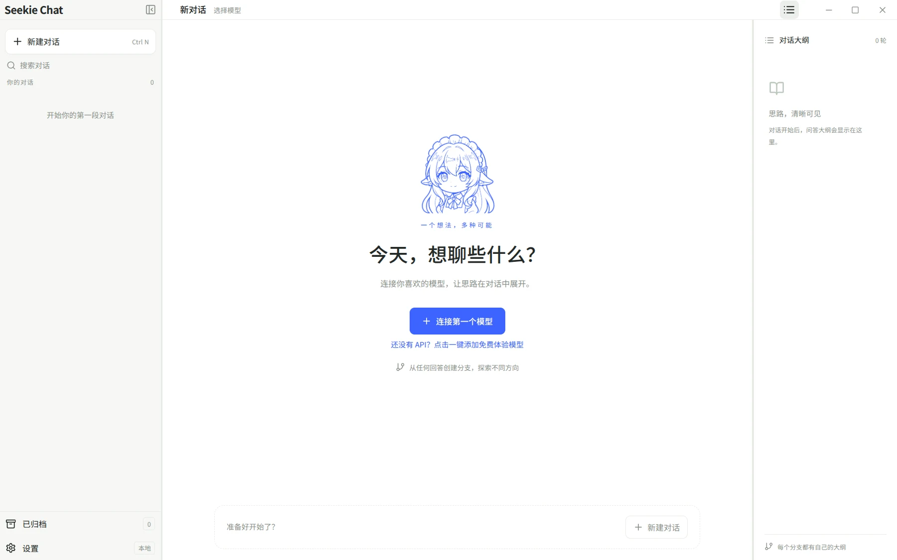
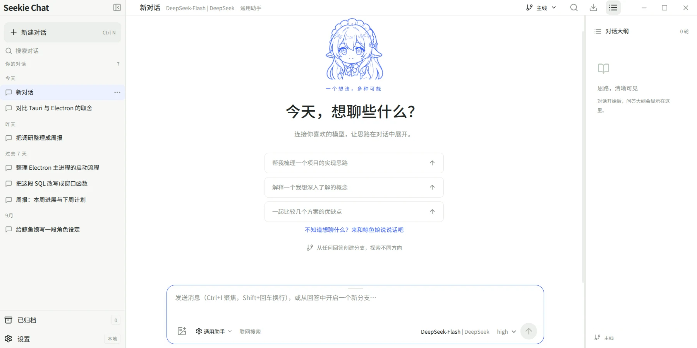
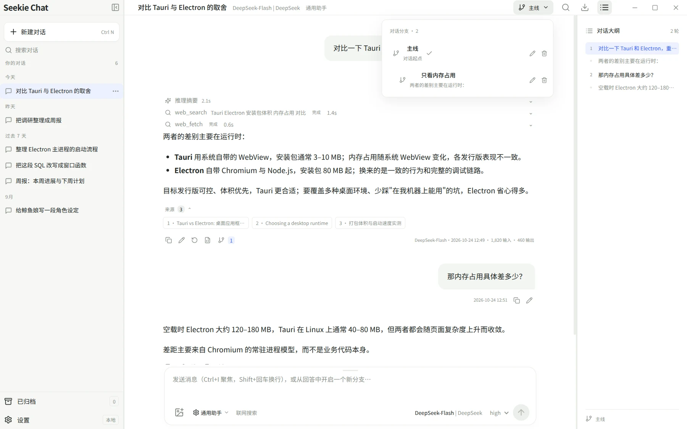
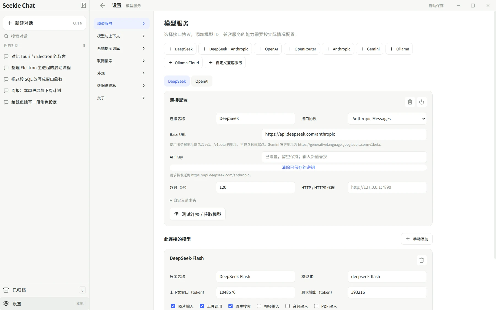
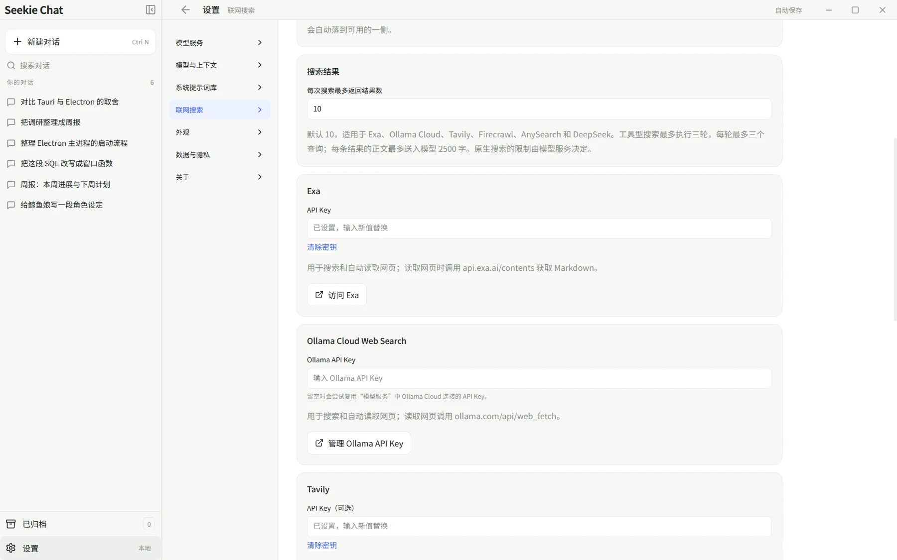
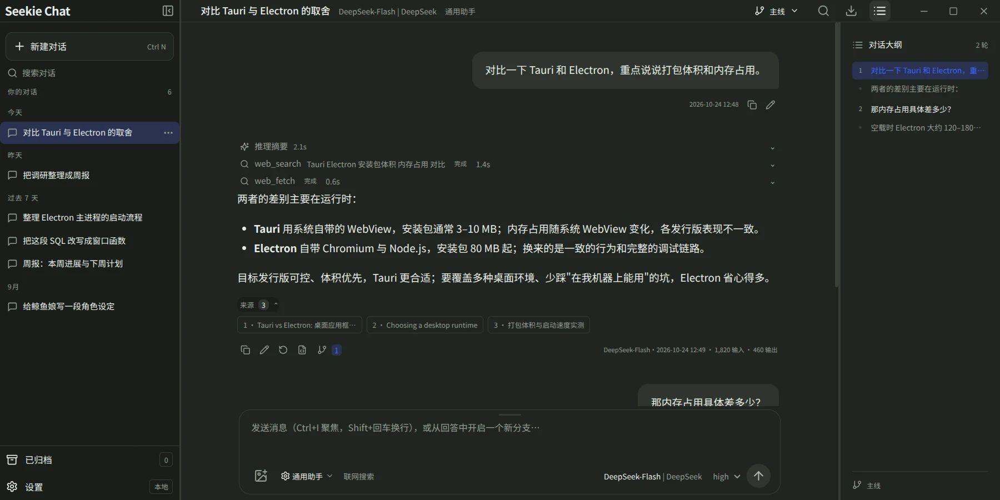

# 界面截图

这些图由 `node scripts/screenshots.mjs` 用模拟数据生成：隔离的临时数据目录、假的连接与对话，不访问网络，也不含真实密钥。界面改动后重跑一次就能更新。

## 主界面

三栏布局：左侧会话列表、中间对话、右侧问答大纲。回答上方是推理摘要与工具调用（工具名后跟查询词），下方是引用来源与用量指标。

## 第一次打开

还没有任何模型时的第一屏。"连接第一个模型"下面那行链接可以直接添加一个免费体验模型——不需要自己的 API Key，点一下就能开始聊。

## 新建对话

配好模型后的第一屏：三个推荐提问、"来和鲸鱼娘说说话吧"入口，以及从回答创建分支的提示。

## 分支

从任意一条回答开分支。每条分支有自己的模型、提示词、搜索与思考配置，历史互不干扰，左侧仍然只有一个会话条目。

## 设置 · 模型服务

四种协议、多个连接可以并存；每个模型单独声明上下文窗口、模态、工具与思考能力。

## 设置 · 联网搜索

模型原生搜索之外，还支持 Exa、Ollama Cloud、Tavily、Firecrawl、AnySearch 与 DeepSeek 搜索；其中 Tavily、Firecrawl、AnySearch 不配 Key 也能用。

## 深色主题

同一屏换成深色，也可以跟随系统。

