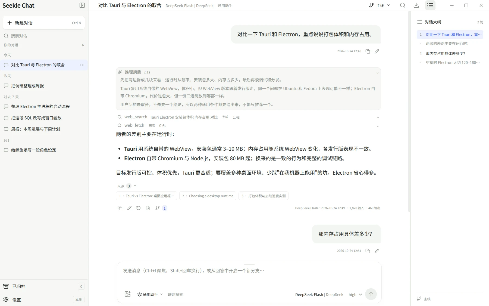
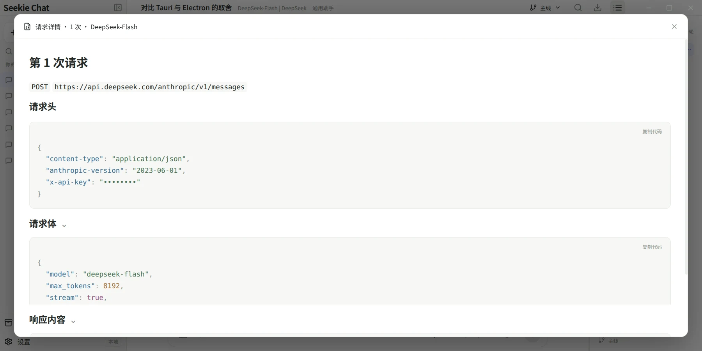
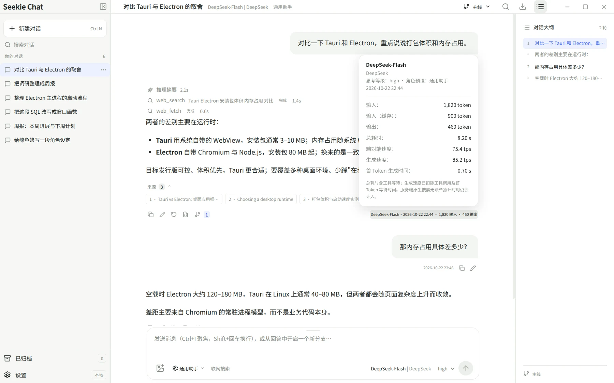
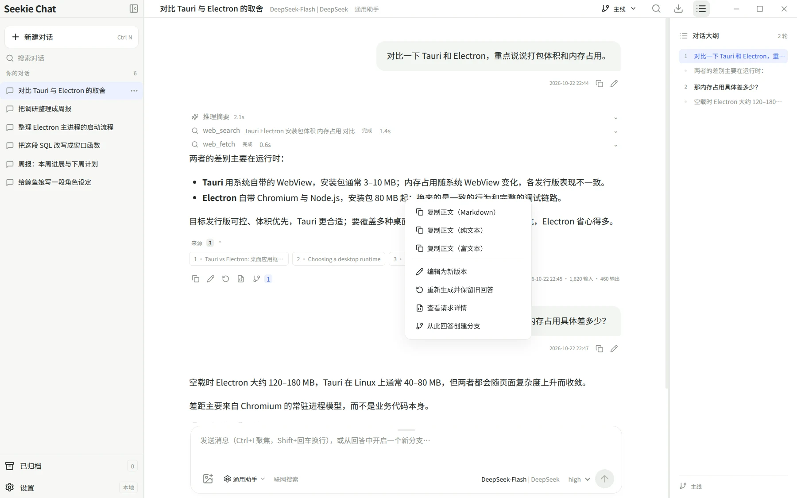

# 界面截图

这些图由 `node scripts/screenshots.mjs` 用模拟数据生成：隔离的临时数据目录、假的连接与对话，不访问网络，也不含真实密钥。界面改动后重跑一次就能更新。

## 主界面

三栏布局：左侧会话列表、中间对话、右侧问答大纲。回答上方是推理摘要与工具调用（工具名后跟查询词），下方是引用来源与用量指标。

## 第一次打开

还没有任何模型时的第一屏。"连接第一个模型"下面那行链接可以直接添加一个免费体验模型——不需要自己的 API Key，点一下就能开始聊。

## 新建对话

配好模型后的第一屏：三个推荐提问、"来和鲸鱼娘说说话吧"入口，以及从回答创建分支的提示。

## 分支

从任意一条回答开分支。每条分支有自己的模型、提示词、搜索与思考配置，历史互不干扰，左侧仍然只有一个会话条目。

## 推理摘要

展开就是模型返回的思考内容，收起时只占一行并带这段推理的耗时。这里只展示服务实际返回的摘要或原文，客户端不推测内部思考；一轮回答里有多段推理时，每段各自计时。

## 请求详情

每条回答都能查到它实际发出的请求：地址、请求头、请求体，以及上游返回的原文。密钥在离开主进程之前就已经被替换成掩码，所以这张图能放心截。记录跟着对话保存在本地，重启后仍可查看。

## 用量详情

回答右侧那串"模型 · 时间 · 输入 · 输出"点开就是完整指标：模型与连接、思考等级与角色预设、输入与缓存命中、输出、总耗时、端对端速度、生成速度，以及首 Token 等待时间。

## 回答右键菜单

一条回答上的操作都收在右键里：三种格式的复制、编辑为新版本、重新生成并保留旧回答、查看请求详情、从此回答创建分支。选中文字时，菜单最前面还会多出"复制选中（纯文本 / 富文本）"两项。

## 多段正文编辑

当一条回答被推理和工具调用隔成好几段正文（推理 → 正文 → 工具 → 正文 → 推理 → 正文），编辑会为每一段各开一个输入框，保存时按原位置写回，中间的推理与工具调用保持不动；清空某一段就等于删掉它。

编辑框刻意画成"一整块文本框、块间一条细线"，而不是几个并排的输入框——它表达的仍然是一段完整的回答。

## 设置 · 模型服务

四种协议、多个连接可以并存；每个模型单独声明上下文窗口、模态、工具与思考能力。

## 设置 · 联网搜索

模型原生搜索之外，还支持 Exa、Ollama Cloud、Tavily、Firecrawl、AnySearch 与 DeepSeek 搜索；其中 Tavily、Firecrawl、AnySearch 不配 Key 也能用。

## 深色主题

同一屏换成深色，也可以跟随系统。

